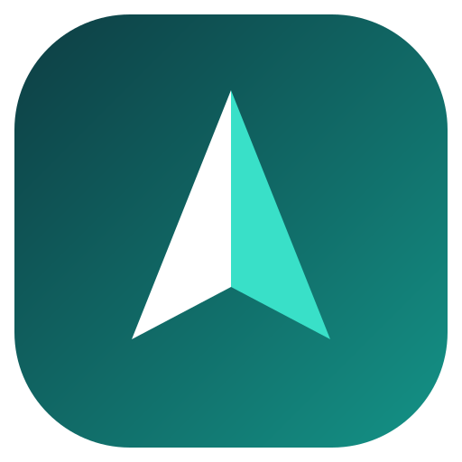
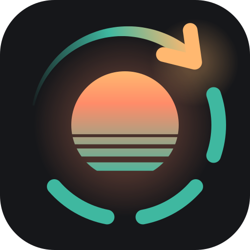

# flip-phone-apks

[App list](#app-list)

This is the full list of third-party Android APKs that I use on my 32-bit ARMv7 Android 10 dumb phone that does not run Google services.

My phone is a ZTE Cymbal 2, but these should work on the TCL Flip 2 or other Android-based dumb/flip phones.

Thanks to [this Reddit post](https://www.reddit.com/r/dumbphones/comments/z6mnil/cymbal_2_installed_apps_list_plus_tips_tricks/) which helped me accumulate an initial list of apps to try on the ZTE Cymbal 2.

Some of these are fully operable with D-Pad navigation. Others may occasionally need a [virtual mouse](#iogithubcrealivitydptvcursor), and the [DPI changer](#comzacharee1dpichanger) requires one. All apps needing a virtual mouse for certain functionality are noted as such, but generally I've tried to choose apps that can be used day-to-day without one.

### How to install APKs

You need to enable developer settings, enable USB debugging, connect via USB to a PC, and with adb, run `adb install app.apk` for each apk you want to install, since your phone probably isn't able to install apps on its own.

Alternatively... once you have [Cx File Explorer](#comcxinventorfileexplorer) and [retsend](#comretsend) installed, you can enable Cx to install apks like this:

```sh
adb shell appops set com.cxinventor.file.explorer REQUEST_INSTALL_PACKAGES allow
```

Then you can send APKs wirelessly to your phone with retsend, and install them from your Downloads folder with Cx File Explorer.

### ⚠️ Finding new APK versions ⚠️

The only places I would recommend finding newer APK versions are, in preferential order:

- The GitHub/Codeberg pages linked
- [F-Droid](https://f-droid.org) (verify what you're downloading)
- [APKMirror](https://www.apkmirror.com/) (verify what you're downloading)
- [APKPure](https://apkpure.com/) (verify what you're downloading)

Do not download APKs from oddly specific websites ranked high in Google search results, that seem to be dedicated only to you obtaining the APK file for this one app.

### Running apps

On some phones (like mine) there is a secret code to access the "all installed apps" page. Mine is hitting the CLR (Back) button 8 times from the home screen.

### App list

The rest of this document explains the usage of the different included APKS

## app.vela



[Source and releases](https://github.com/PimpinPumpkin/Vela)

### App name

Vela Maps

### What it is

A Google Maps alternative that is more-or-less fully usable with D-Pad + OK.

### Gotchas

#### Offline maps

The offline maps can be huge in terms of device footprint for a dumb phone. I recommend getting the offline maps, but just download the area you need.

#### For distractionless navigation

The app has voice directions functionality that does not work, at least on my phone, although that can be sorely missing if you're biking and can't look at your phone.

Instead, enable the feature that vibrates with different patterns to indicate left and right turns. With a bit of practice, this can be used to navigate eyes-free and hands-free.

## com.beemdevelopment.aegis


[Source and releases](https://github.com/beemdevelopment/aegis)

### App name

Aegis Authenticator

### What it is

An authenticator app similar to Google Authenticator, which can be used for 2FA with most platforms that support it.

### Gotchas

#### Navigation

This app is mostly usable with d-pad controls, but there are a couple of notable hangups where you will need a [virtual mouse](#iogithubcrealivitydptvcursor) while registering a new entry:

1. When you open the + menu, you need to select "enter manually" (unless your phone reads QR codes well, which mine does not). I had to use the mouse to click this button.

2. When you get to the "enter manually" screen, you need to focus the first field using the mouse.

#### Adding the entry code

As mentioned, you probably need to type in the registration code manually, which can be long and tedious.

#### After adding new entry

After you finish registering an entry, you'll land on an empty registration screen, and if you hit back, you won't see the new entry. Exit the app and come back. It will be there at the end of the list now.

## com.cxinventor.file.explorer


*There's no "official" apk source other than the Play store. I recommend APKMirror if you need another version.*

[Found at APKMirror](https://www.apkmirror.com/apk/cx-file-explorer/cx-file-explorer/)

### App name

Cx File Explorer

### What it is

A file explorer that adds some useful functionality beyond your basic file explorer, including:

- Installing APKs (if authorized)
- Uninstalling apps
- Opening more file types than the default file explorer (at least on my phone, e.g. EPUBs)
- Browsing files on Samba shares

### Gotchas

#### Navigation

Not all functionality is accessible via D-Pad navigation, but the essentials I mentioned are. To access context menus for advanced options, you might need to pull out a [virtual mouse](#iogithubcrealivitydptvcursor).

#### After installing/removing apps

After installing or removing an app, Cx File Explorer basically stops working. You need to hit back until the app exits, and reopen the app to continue.

## com.evdeman.flip2calendar


[Source and releases](https://github.com/jevdemon/flip2calendar)

### App name

Flip2Calendar

### What it is

A calendar app that syncs with Google events and tasks

### Gotchas

#### Setup

The setup of creating a developer app, connecting to google from your phone, etc is doable and well documented, but long and tedious

#### Re-syncing

The app only really re-syncs when the phone boots up, and then whenever you re-open the app after awhile. Also lately, it kind of stopped working for me, and I need to investigate why. So your mileage may vary.

#### Creating new calendar items

I wouldn't recommend doing this inside the app. You can't choose a different time without the app bugging, and not all features are accessible.

## com.raiiware.forcestophelper


[Source and releases](https://codeberg.org/raiiware/ForceStopHelper)

### App name

Force Stop Helper

### What it is

An app whose only purpose is to kill another app, since your flip phone probably doesn't have the task killer view built-in that most Android phones have.

## com.retsend



[Source and releases](https://github.com/mxmgorin/retsend)

### App name

retsend

### What it is

A client for LocalSend. Pair it with the LocalSend app on your computer to send files to your phone over the same Wi-Fi network. The official LocalSend app also works, but this one is smaller and has better d-pad/button navigation.

### Gotchas

#### UI size

The default UI is pretty small. I would recommend going into the settings and increasing the UI size to 140% or 160%, which might bleed over the edges a bit, but you'll find the app is easier to read and use.

## com.rickgram.NoBrowser


[Source and releases](https://github.com/rickgram/NoBrowser)

### App name

NoBrowser

### What it is

If you're like me and trying to limit distractions, you uninstalled your web browser. But very occasionally, you need to open a link.. for a sign in, to look at the youtube video your friend texted you, whatever.

NoBrowser lets you open links to web pages, but it doesn't let you look up web addresses directy.

## com.zacharee1.dpichanger


*This is sort of a sketchy, old download, use at your own risk.*

[Found at APKPure](https://apkpure.com/dpi-changer/com.zacharee1.dpichanger/download)

### App name

DPI Changer

### What it is

An app that changes the DPI on a phone (to make the UI smaller and fit better on the small display), which is sometimes useful for improving usability of apps.

My default DPI is 160. I usually set it to 80 when I'm overriding the DPI.

I only use this for rare configuration needs, not on a daily basis.

### Gotchas

#### Virtual mouse required

It requires a [virtual mouse](#iogithubcrealivitydptvcursor) to work. Perhaps a better version should be recommended. If you have a suggestion, feel free to make a PR!

## io.github.crealivity.dptvcursor


[Source and releases](https://github.com/Crealivity/DPTV-Cursor)

### App name

DPTV Cursor

### What it is

A virtual mouse that can appear onscreen on command. You long-press the "mute" button to activate, long press again to deactivate.

While the mouse is activated, you can short-press the "mute" button to toggle between **pointer move mode** and **scroll mode**.

### Gotchas

Pressing OK to click the mouse does not work, at least not on my phone. My workaround is to move the mouse where I need to click, activate **scroll mode**, and quickly press and release the D-Pad down arrow, which should register as a screen tap.

This is indeed annoying to do. That's why I recommend apps that usually don't require a virtual mouse.

## mobi.lockdown.weather


*Old build from 2022, because the newer version didn't work for me.*

[Found at APKMirror](https://www.apkmirror.com/apk/todayweather-co/today-weather-forecast-radar-severe-alert/today-weather-forecast-radar-severe-alert-1-5-0-13-300720-release/today-weather-widget-forecast-radar-alert-1-5-0-13-300720-android-apk-download/)

### App name

Today Weather

### What it is

A weather app which, if configured for just one location, can show all its essential information with D-Pad navigation. It also sends a daily notification with weather information, whose time can be configured.

### Gotchas

#### Virtual mouse for configuration

To configure the app, you need a [virtual mouse](#iogithubcrealivitydptvcursor). Afterward, you can use it without one.

## org.benwiley.bixi4flip


[Source and releases](https://github.com/benwiley4000/bixi4flip)

### App name

Bixi 4 Flip

### What it is

Useless if you're not in the province of Québec.

Shows the map of the Bixi bikeshare system, with D-Pad navigation.

## org.benwiley.stm4flip


[Source and releases](https://github.com/benwiley4000/stm4flip)

### App name

STM 4 Flip

### What it is

Useless if you're not in Montréal, Québec.

Shows the locations of nearby STM bus stops and what times the next 3 buses will arrive.

## org.koreader.launcher


[Source and releases](https://github.com/koreader/koreader)

### App name

KO Reader

### What it is

An e-book and PDF reader that works with either volume or arrow controls for changing pages.

### Gotchas

### Only the actual reading part works

You're gonna have no luck browsing in-app to choose a book, and you won't be able to access the reader configuration. But it works for reading!

For actually opening e-books, I recommend [Cx File Explorer](#comcxinventorfileexplorer), since the default file explorer may not launch KO Reader correctly.

### PDFs are readable, but barely

You can't zoom, so most PDFs are very tiny and hardly legible, if at all.

If you have a choice to use EPUB instead of PDF, it's a much better experience.

## org.korosoft.simplenotepad.android


*I could only find this one at APKPure*

[Found at APKPure](https://apkpure.com/notepad/org.korosoft.simplenotepad.android)

### App name

Notepad

### What it is

A basic notepad application that lets you access 3 pages of notes via D-Pad navigation.

The functionality is very basic and not extra ergonomic, compared to more mainstream note-taking applications. But it's useful if you really need to write something down, and possibly send it to yourself (via SMS or email).

